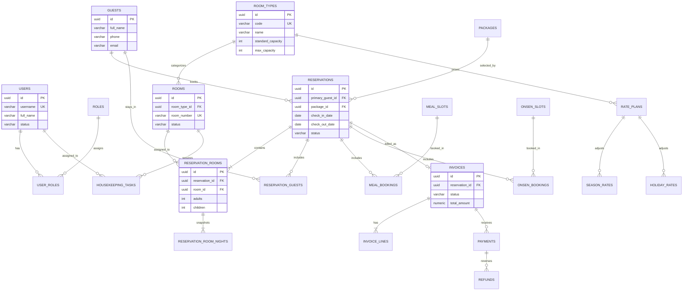

# Thiết kế ERD và Database — Ryokan Management System

## 1. Quy ước dữ liệu

- Database: PostgreSQL 16; schema mặc định `public`.
- Khóa chính dùng `UUID`; tiền tệ dùng `NUMERIC(14,2)`; thời gian lưu `TIMESTAMPTZ` và ngày nghiệp vụ dùng `DATE`.
- Các cột `created_at`, `updated_at` thuộc các bảng nghiệp vụ chính và được quản lý ở tầng ứng dụng/audit.
- Không xóa cứng dữ liệu tài chính và đặt phòng; dùng trạng thái hoặc cột `deleted_at` khi cần.

## 2. ERD



## 3. DDL PostgreSQL khởi tạo

```sql
CREATE EXTENSION IF NOT EXISTS pgcrypto;

CREATE TYPE room_status AS ENUM ('READY', 'RESERVED', 'OCCUPIED', 'DIRTY', 'CLEANING', 'MAINTENANCE');
CREATE TYPE reservation_status AS ENUM ('HOLD', 'CONFIRMED', 'CHECKED_IN', 'CHECKED_OUT', 'CANCELLED', 'NO_SHOW');
CREATE TYPE task_status AS ENUM ('PENDING', 'IN_PROGRESS', 'COMPLETED', 'ISSUE_REPORTED', 'CANCELLED');
CREATE TYPE invoice_status AS ENUM ('DRAFT', 'OPEN', 'PAID', 'PARTIALLY_PAID', 'VOID', 'REFUNDED');
CREATE TYPE payment_method AS ENUM ('CASH', 'CARD', 'BANK_TRANSFER', 'ONLINE');
CREATE TYPE payment_status AS ENUM ('PENDING', 'COMPLETED', 'FAILED', 'REFUNDED', 'PARTIALLY_REFUNDED');

CREATE TABLE users (
    id UUID PRIMARY KEY DEFAULT gen_random_uuid(),
    username VARCHAR(100) NOT NULL UNIQUE,
    password_hash VARCHAR(255) NOT NULL,
    full_name VARCHAR(200) NOT NULL,
    email VARCHAR(254), phone VARCHAR(30), status VARCHAR(30) NOT NULL DEFAULT 'ACTIVE',
    created_at TIMESTAMPTZ NOT NULL DEFAULT now(), updated_at TIMESTAMPTZ NOT NULL DEFAULT now()
);
CREATE TABLE roles (id UUID PRIMARY KEY DEFAULT gen_random_uuid(), code VARCHAR(50) NOT NULL UNIQUE, name VARCHAR(100) NOT NULL);
CREATE TABLE user_roles (user_id UUID NOT NULL REFERENCES users(id), role_id UUID NOT NULL REFERENCES roles(id), PRIMARY KEY (user_id, role_id));

CREATE TABLE room_types (
    id UUID PRIMARY KEY DEFAULT gen_random_uuid(), code VARCHAR(50) NOT NULL UNIQUE, name VARCHAR(150) NOT NULL,
    description TEXT, standard_capacity SMALLINT NOT NULL CHECK (standard_capacity > 0),
    max_capacity SMALLINT NOT NULL CHECK (max_capacity >= standard_capacity), area_sqm NUMERIC(7,2), amenities JSONB NOT NULL DEFAULT '[]'::jsonb,
    created_at TIMESTAMPTZ NOT NULL DEFAULT now(), updated_at TIMESTAMPTZ NOT NULL DEFAULT now()
);
CREATE TABLE rooms (
    id UUID PRIMARY KEY DEFAULT gen_random_uuid(), room_type_id UUID NOT NULL REFERENCES room_types(id),
    room_number VARCHAR(30) NOT NULL UNIQUE, floor VARCHAR(20), status room_status NOT NULL DEFAULT 'READY',
    note TEXT, created_at TIMESTAMPTZ NOT NULL DEFAULT now(), updated_at TIMESTAMPTZ NOT NULL DEFAULT now()
);
CREATE TABLE rate_plans (
    id UUID PRIMARY KEY DEFAULT gen_random_uuid(), room_type_id UUID NOT NULL REFERENCES room_types(id),
    code VARCHAR(50) NOT NULL UNIQUE, name VARCHAR(150) NOT NULL, base_amount NUMERIC(14,2) NOT NULL CHECK (base_amount >= 0),
    currency CHAR(3) NOT NULL DEFAULT 'JPY', included_guests SMALLINT NOT NULL DEFAULT 1 CHECK (included_guests > 0),
    extra_adult_amount NUMERIC(14,2) NOT NULL DEFAULT 0, extra_child_amount NUMERIC(14,2) NOT NULL DEFAULT 0,
    effective_from DATE NOT NULL, effective_to DATE, CHECK (effective_to IS NULL OR effective_to >= effective_from)
);
CREATE TABLE season_rates (
    id UUID PRIMARY KEY DEFAULT gen_random_uuid(), rate_plan_id UUID NOT NULL REFERENCES rate_plans(id), name VARCHAR(150) NOT NULL,
    start_date DATE NOT NULL, end_date DATE NOT NULL, priority SMALLINT NOT NULL DEFAULT 0,
    adjustment_amount NUMERIC(14,2) NOT NULL DEFAULT 0, override_amount NUMERIC(14,2), CHECK (end_date >= start_date)
);
CREATE TABLE holiday_rates (
    id UUID PRIMARY KEY DEFAULT gen_random_uuid(), rate_plan_id UUID NOT NULL REFERENCES rate_plans(id), holiday_date DATE NOT NULL,
    name VARCHAR(150) NOT NULL, adjustment_amount NUMERIC(14,2) NOT NULL DEFAULT 0, override_amount NUMERIC(14,2),
    UNIQUE (rate_plan_id, holiday_date)
);

CREATE TABLE guests (
    id UUID PRIMARY KEY DEFAULT gen_random_uuid(), full_name VARCHAR(200) NOT NULL, nationality VARCHAR(80),
    date_of_birth DATE, phone VARCHAR(30), email VARCHAR(254), document_type VARCHAR(30), document_number VARCHAR(100),
    address TEXT, dietary_requirements TEXT, special_request TEXT,
    created_at TIMESTAMPTZ NOT NULL DEFAULT now(), updated_at TIMESTAMPTZ NOT NULL DEFAULT now()
);
CREATE TABLE packages (
    id UUID PRIMARY KEY DEFAULT gen_random_uuid(), code VARCHAR(50) NOT NULL UNIQUE, name VARCHAR(150) NOT NULL,
    description TEXT, amount NUMERIC(14,2) NOT NULL CHECK (amount >= 0), currency CHAR(3) NOT NULL DEFAULT 'JPY',
    includes_kaiski BOOLEAN NOT NULL DEFAULT false, includes_onsen BOOLEAN NOT NULL DEFAULT false,
    effective_from DATE NOT NULL, effective_to DATE, active BOOLEAN NOT NULL DEFAULT true,
    CHECK (effective_to IS NULL OR effective_to >= effective_from)
);
CREATE TABLE reservations (
    id UUID PRIMARY KEY DEFAULT gen_random_uuid(), reservation_no VARCHAR(30) NOT NULL UNIQUE,
    primary_guest_id UUID NOT NULL REFERENCES guests(id), package_id UUID REFERENCES packages(id),
    check_in_date DATE NOT NULL, check_out_date DATE NOT NULL, status reservation_status NOT NULL DEFAULT 'HOLD',
    source VARCHAR(30) NOT NULL DEFAULT 'DIRECT', special_request TEXT, currency CHAR(3) NOT NULL DEFAULT 'JPY',
    created_by UUID REFERENCES users(id), created_at TIMESTAMPTZ NOT NULL DEFAULT now(), updated_at TIMESTAMPTZ NOT NULL DEFAULT now(),
    CHECK (check_out_date > check_in_date)
);
CREATE TABLE reservation_rooms (
    id UUID PRIMARY KEY DEFAULT gen_random_uuid(), reservation_id UUID NOT NULL REFERENCES reservations(id),
    room_id UUID NOT NULL REFERENCES rooms(id), adults SMALLINT NOT NULL DEFAULT 1 CHECK (adults > 0),
    children SMALLINT NOT NULL DEFAULT 0 CHECK (children >= 0), assigned_at TIMESTAMPTZ NOT NULL DEFAULT now(),
    UNIQUE (reservation_id, room_id)
);
CREATE TABLE reservation_guests (
    reservation_id UUID NOT NULL REFERENCES reservations(id), guest_id UUID NOT NULL REFERENCES guests(id),
    reservation_room_id UUID REFERENCES reservation_rooms(id), is_primary BOOLEAN NOT NULL DEFAULT false,
    PRIMARY KEY (reservation_id, guest_id)
);
CREATE TABLE reservation_room_nights (
    id UUID PRIMARY KEY DEFAULT gen_random_uuid(), reservation_room_id UUID NOT NULL REFERENCES reservation_rooms(id),
    stay_date DATE NOT NULL, base_amount NUMERIC(14,2) NOT NULL, seasonal_adjustment NUMERIC(14,2) NOT NULL DEFAULT 0,
    guest_surcharge NUMERIC(14,2) NOT NULL DEFAULT 0, discount_amount NUMERIC(14,2) NOT NULL DEFAULT 0,
    total_amount NUMERIC(14,2) NOT NULL, price_detail JSONB NOT NULL DEFAULT '{}'::jsonb,
    UNIQUE (reservation_room_id, stay_date)
);

CREATE TABLE meal_slots (
    id UUID PRIMARY KEY DEFAULT gen_random_uuid(), name VARCHAR(100) NOT NULL, service_time TIME NOT NULL,
    capacity SMALLINT NOT NULL CHECK (capacity > 0), active BOOLEAN NOT NULL DEFAULT true
);
CREATE TABLE meal_bookings (
    id UUID PRIMARY KEY DEFAULT gen_random_uuid(), reservation_id UUID NOT NULL REFERENCES reservations(id),
    meal_slot_id UUID NOT NULL REFERENCES meal_slots(id), booking_date DATE NOT NULL, guests SMALLINT NOT NULL CHECK (guests > 0),
    menu_note TEXT, status VARCHAR(20) NOT NULL DEFAULT 'BOOKED'
);
CREATE TABLE onsen_slots (
    id UUID PRIMARY KEY DEFAULT gen_random_uuid(), name VARCHAR(100) NOT NULL, onsen_type VARCHAR(20) NOT NULL,
    start_time TIME NOT NULL, end_time TIME NOT NULL, capacity SMALLINT NOT NULL CHECK (capacity > 0),
    gender_rule VARCHAR(30), active BOOLEAN NOT NULL DEFAULT true, CHECK (end_time > start_time)
);
CREATE TABLE onsen_bookings (
    id UUID PRIMARY KEY DEFAULT gen_random_uuid(), reservation_id UUID NOT NULL REFERENCES reservations(id),
    onsen_slot_id UUID NOT NULL REFERENCES onsen_slots(id), booking_date DATE NOT NULL,
    guests SMALLINT NOT NULL CHECK (guests > 0), status VARCHAR(20) NOT NULL DEFAULT 'BOOKED'
);

CREATE TABLE housekeeping_tasks (
    id UUID PRIMARY KEY DEFAULT gen_random_uuid(), room_id UUID NOT NULL REFERENCES rooms(id),
    reservation_id UUID REFERENCES reservations(id), assigned_to UUID REFERENCES users(id),
    task_date DATE NOT NULL, due_at TIMESTAMPTZ, status task_status NOT NULL DEFAULT 'PENDING', priority SMALLINT NOT NULL DEFAULT 0,
    note TEXT, issue_note TEXT, started_at TIMESTAMPTZ, completed_at TIMESTAMPTZ,
    created_at TIMESTAMPTZ NOT NULL DEFAULT now(), updated_at TIMESTAMPTZ NOT NULL DEFAULT now()
);

CREATE TABLE invoices (
    id UUID PRIMARY KEY DEFAULT gen_random_uuid(), invoice_no VARCHAR(30) NOT NULL UNIQUE,
    reservation_id UUID NOT NULL UNIQUE REFERENCES reservations(id), status invoice_status NOT NULL DEFAULT 'DRAFT', currency CHAR(3) NOT NULL DEFAULT 'JPY',
    subtotal_amount NUMERIC(14,2) NOT NULL DEFAULT 0, discount_amount NUMERIC(14,2) NOT NULL DEFAULT 0,
    tax_amount NUMERIC(14,2) NOT NULL DEFAULT 0, total_amount NUMERIC(14,2) NOT NULL DEFAULT 0, issued_at TIMESTAMPTZ,
    created_at TIMESTAMPTZ NOT NULL DEFAULT now(), updated_at TIMESTAMPTZ NOT NULL DEFAULT now()
);
CREATE TABLE invoice_lines (
    id UUID PRIMARY KEY DEFAULT gen_random_uuid(), invoice_id UUID NOT NULL REFERENCES invoices(id), line_type VARCHAR(30) NOT NULL,
    description VARCHAR(255) NOT NULL, quantity NUMERIC(10,2) NOT NULL DEFAULT 1, unit_amount NUMERIC(14,2) NOT NULL,
    total_amount NUMERIC(14,2) NOT NULL, service_date DATE, reference_id UUID
);
CREATE TABLE payments (
    id UUID PRIMARY KEY DEFAULT gen_random_uuid(), invoice_id UUID NOT NULL REFERENCES invoices(id), method payment_method NOT NULL,
    status payment_status NOT NULL DEFAULT 'PENDING', amount NUMERIC(14,2) NOT NULL CHECK (amount > 0),
    reference VARCHAR(100), paid_at TIMESTAMPTZ, received_by UUID REFERENCES users(id), created_at TIMESTAMPTZ NOT NULL DEFAULT now()
);
CREATE TABLE refunds (
    id UUID PRIMARY KEY DEFAULT gen_random_uuid(), payment_id UUID NOT NULL REFERENCES payments(id), amount NUMERIC(14,2) NOT NULL CHECK (amount > 0),
    reason TEXT NOT NULL, refunded_at TIMESTAMPTZ NOT NULL DEFAULT now(), refunded_by UUID REFERENCES users(id)
);
```

## 4. Chỉ mục, ràng buộc và quy tắc cần triển khai thêm

```sql
CREATE INDEX idx_reservations_stay_dates ON reservations (check_in_date, check_out_date, status);
CREATE INDEX idx_reservation_rooms_room ON reservation_rooms (room_id);
CREATE INDEX idx_housekeeping_tasks_assignee_status ON housekeeping_tasks (assigned_to, status, due_at);
CREATE INDEX idx_meal_bookings_date_slot ON meal_bookings (booking_date, meal_slot_id);
CREATE INDEX idx_onsen_bookings_date_slot ON onsen_bookings (booking_date, onsen_slot_id);
CREATE INDEX idx_payments_invoice ON payments (invoice_id, status);
```

- Kiểm tra phòng chồng lấn phải chạy trong transaction khi xác nhận/check-in. Có thể dùng PostgreSQL exclusion constraint với `daterange` sau khi tách lịch giữ phòng theo trạng thái hoạt động, hoặc khóa hàng `rooms` kết hợp truy vấn overlap.
- Sức chứa Kaiseki và onsen cần được kiểm tra bằng tổng `guests` của các booking trạng thái `BOOKED`/`CONFIRMED` cùng ngày/ca; dùng khóa transaction để tránh overbooking.
- Với onsen riêng tư, thêm unique constraint trên `(onsen_slot_id, booking_date)` nếu một khung giờ chỉ phục vụ duy nhất một nhóm; onsen công cộng thì áp dụng kiểm tra tổng sức chứa.
- Tổng `refunds.amount` theo `payment_id` không được vượt `payments.amount`; kiểm tra ở service layer hoặc trigger.
- `reservation_room_nights`, `invoice_lines` là dữ liệu snapshot bất biến về giá để bảo toàn lịch sử.
