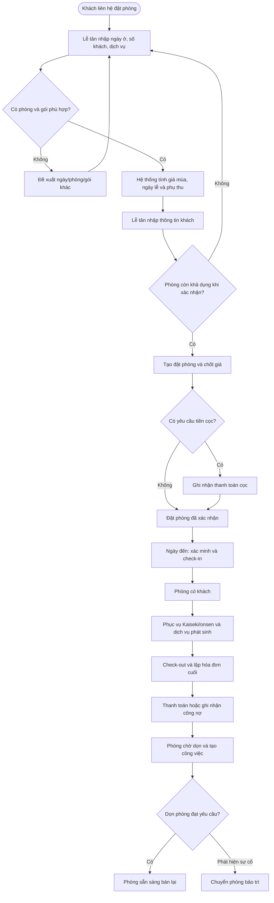
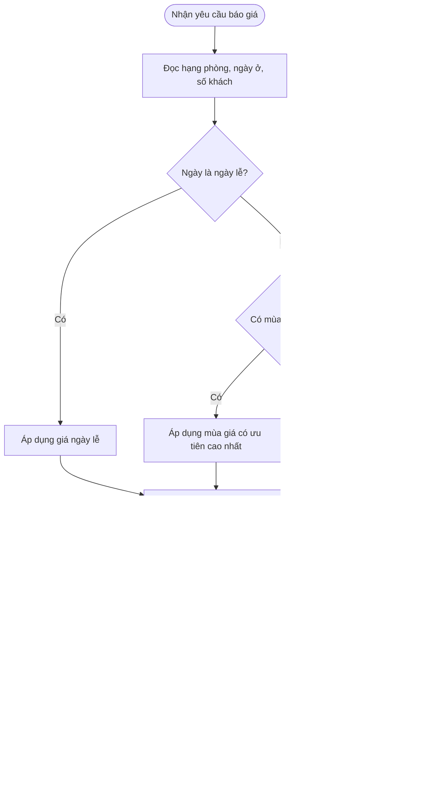

# Use Case, User Story và Process Flow — Hệ thống quản lý Ryokan

## 1. Tác nhân

| Tác nhân | Mô tả |
| --- | --- |
| Khách lưu trú | Người đặt phòng, dùng dịch vụ và thanh toán. |
| Lễ tân | Tiếp nhận đặt phòng, check-in/check-out, thu tiền. |
| Quản lý vận hành | Thiết lập giá, điều phối phòng và nhân sự. |
| Nhân viên buồng phòng | Dọn phòng, cập nhật trạng thái và sự cố. |
| Nhân viên phục vụ | Chuẩn bị/phục vụ Kaiseki và onsen. |
| Kế toán | Đối soát hóa đơn, giao dịch và hoàn tiền. |

## 2. Danh sách Use Case

| Mã | Use Case | Tác nhân chính | Kết quả |
| --- | --- | --- | --- |
| UC-01 | Tra cứu phòng khả dụng và báo giá | Lễ tân | Danh sách phòng/gói phù hợp cùng chi tiết giá. |
| UC-02 | Tạo và xác nhận đặt phòng | Lễ tân | Đặt phòng được giữ chỗ hoặc xác nhận, có tiền cọc nếu có. |
| UC-03 | Điều chỉnh/hủy đặt phòng | Lễ tân, Quản lý | Đặt phòng và giá/hoàn tiền được cập nhật có lịch sử. |
| UC-04 | Check-in | Lễ tân | Khách được nhận phòng; phòng chuyển sang `Có khách`. |
| UC-05 | Đăng ký Kaiseki và onsen | Lễ tân, Nhân viên phục vụ | Lịch phục vụ được xác nhận, không quá sức chứa/trùng giờ. |
| UC-06 | Phân công và hoàn tất dọn phòng | Quản lý, Nhân viên buồng phòng | Phòng trở thành `Sẵn sàng` hoặc chuyển `Bảo trì`. |
| UC-07 | Check-out, lập hóa đơn và thanh toán | Lễ tân, Kế toán | Hóa đơn được chốt; phòng chuyển sang `Chờ dọn`. |
| UC-08 | Thiết lập giá mùa/ngày lễ | Quản lý vận hành | Bảng giá có hiệu lực cho các báo giá/đặt phòng mới. |

## 3. Use Case chi tiết

### UC-01 — Tra cứu phòng khả dụng và báo giá

- **Tác nhân chính:** Lễ tân.
- **Tiền điều kiện:** Hạng phòng, bảng giá và trạng thái phòng đã được cấu hình.
- **Luồng chính:**
  1. Lễ tân nhập ngày đến, ngày đi, số người lớn/trẻ em và nhu cầu dịch vụ.
  2. Hệ thống loại các phòng đang có khách, đã giữ chỗ, chờ dọn, đang dọn hoặc bảo trì trong khoảng thời gian chọn.
  3. Hệ thống kiểm tra sức chứa, tồn suất Kaiseki/onsen (nếu được chọn).
  4. Hệ thống tính giá từng đêm theo ngày lễ, mùa, giá cơ sở và phụ thu số khách.
  5. Hệ thống hiển thị các lựa chọn phù hợp cùng tổng tiền dự kiến.
- **Ngoại lệ:** Không có phòng/gói phù hợp → thông báo hết chỗ và đề xuất ngày, hạng phòng hoặc gói khác.
- **Hậu điều kiện:** Chưa phát sinh giữ chỗ; báo giá có thể dùng để tạo đặt phòng.

### UC-02 — Tạo và xác nhận đặt phòng

- **Tác nhân chính:** Lễ tân.
- **Tiền điều kiện:** Có lựa chọn hợp lệ từ UC-01.
- **Luồng chính:**
  1. Lễ tân chọn phòng/gói và nhập thông tin khách đại diện, khách cùng đoàn, yêu cầu ăn uống và yêu cầu đặc biệt.
  2. Hệ thống kiểm tra lại khả dụng để tránh xung đột phát sinh đồng thời.
  3. Hệ thống chốt chi tiết giá tại thời điểm đặt, tạo mã đặt phòng và trạng thái `Giữ chỗ`.
  4. Lễ tân ghi nhận tiền cọc hoặc thanh toán trước (nếu có).
  5. Sau khi đáp ứng điều kiện xác nhận, hệ thống chuyển đặt phòng sang `Đã xác nhận` và giữ phòng.
- **Ngoại lệ:** Phòng vừa được người khác đặt → quay lại UC-01. Thanh toán cọc thất bại → giữ trạng thái `Giữ chỗ` hoặc hủy theo chính sách.
- **Hậu điều kiện:** Đặt phòng có giá chốt, phòng được giữ cho thời gian lưu trú.

### UC-04 — Check-in

- **Tác nhân chính:** Lễ tân.
- **Tiền điều kiện:** Đặt phòng đã xác nhận, ngày đến hợp lệ và phòng sẵn sàng.
- **Luồng chính:**
  1. Lễ tân tìm mã đặt phòng hoặc thông tin khách.
  2. Xác minh giấy tờ, số khách thực tế, thông tin liên hệ và yêu cầu đặc biệt.
  3. Hệ thống cập nhật phụ thu hoặc dịch vụ nếu số khách/dịch vụ thay đổi.
  4. Lễ tân thu số tiền đến hạn.
  5. Hệ thống gán phòng, chuyển đặt phòng sang `Đã check-in` và phòng sang `Có khách`.
- **Ngoại lệ:** Phòng chưa sẵn sàng → chuyển phòng tương đương hoặc thông báo thời gian chờ. Khách không đến → xử lý UC-03 theo chính sách no-show.
- **Hậu điều kiện:** Khách có phòng lưu trú và danh sách dịch vụ phục vụ được cập nhật.

### UC-06 — Phân công và hoàn tất dọn phòng

- **Tác nhân chính:** Quản lý vận hành, Nhân viên buồng phòng.
- **Tiền điều kiện:** Có phòng `Chờ dọn` sau check-out hoặc có lịch dọn định kỳ.
- **Luồng chính:**
  1. Hệ thống tạo công việc dọn phòng với mức ưu tiên theo giờ check-in kế tiếp.
  2. Quản lý phân công nhân viên, ca làm và thời hạn hoàn tất.
  3. Nhân viên nhận việc, chuyển công việc sang `Đang làm`.
  4. Sau khi dọn và kiểm tra, nhân viên cập nhật `Hoàn tất`.
  5. Hệ thống chuyển phòng sang `Sẵn sàng`.
- **Ngoại lệ:** Phát hiện hư hỏng → nhân viên ghi nhận sự cố; quản lý chuyển phòng sang `Bảo trì` và không cho bán.
- **Hậu điều kiện:** Phòng sẵn sàng bán hoặc được cô lập để bảo trì.

### UC-07 — Check-out, lập hóa đơn và thanh toán

- **Tác nhân chính:** Lễ tân.
- **Tiền điều kiện:** Khách đang ở (`Đã check-in`).
- **Luồng chính:**
  1. Lễ tân kiểm tra các khoản tiền phòng, Kaiseki, onsen, phụ thu và dịch vụ phát sinh.
  2. Hệ thống tạo hóa đơn cuối cùng, khấu trừ tiền cọc và tính số dư.
  3. Lễ tân ghi nhận thanh toán hoặc hoàn tiền.
  4. Hệ thống chốt hóa đơn, chuyển đặt phòng sang `Đã check-out`.
  5. Hệ thống đổi phòng thành `Chờ dọn` và tự tạo công việc dọn phòng.
- **Ngoại lệ:** Khách còn khoản chưa thanh toán → hóa đơn ở trạng thái chưa thanh toán, ghi nhận công nợ theo quyền hạn.
- **Hậu điều kiện:** Hóa đơn/giao dịch có thể đối soát; phòng không thể bán đến khi dọn xong.

## 4. User Story

| Mã | User Story | Tiêu chí chấp nhận |
| --- | --- | --- |
| US-01 | Là lễ tân, tôi muốn tìm phòng theo ngày ở và số khách để báo giá nhanh cho khách. | Chỉ hiện phòng còn trống, đúng sức chứa và giá được tách theo từng đêm. |
| US-02 | Là lễ tân, tôi muốn tạo đặt phòng nhiều phòng cho một đoàn để quản lý tập trung. | Một mã đặt phòng có nhiều phòng và danh sách khách theo từng phòng. |
| US-03 | Là lễ tân, tôi muốn thu tiền cọc để xác nhận giữ phòng. | Giao dịch lưu phương thức, số tiền, thời gian và số dư còn lại. |
| US-04 | Là quản lý, tôi muốn thiết lập giá mùa và ngày lễ để tối ưu doanh thu. | Ngày lễ ưu tiên hơn mùa; giá đã chốt không thay đổi trên đặt phòng cũ. |
| US-05 | Là nhân viên phục vụ, tôi muốn xem khách dùng Kaiseki theo ca để chuẩn bị đúng suất ăn. | Danh sách có ngày, ca, số khách, thực đơn và cảnh báo dị ứng. |
| US-06 | Là lễ tân, tôi muốn đặt onsen riêng theo khung giờ để tránh trùng lịch. | Không thể xác nhận hai lượt trùng giờ hoặc vượt sức chứa. |
| US-07 | Là quản lý, tôi muốn phân công dọn phòng theo ưu tiên để phòng kịp nhận khách mới. | Việc dọn có người phụ trách, hạn hoàn tất và trạng thái tiến độ. |
| US-08 | Là nhân viên buồng phòng, tôi muốn báo hư hỏng trong lúc dọn để phòng không bị bán nhầm. | Báo sự cố chuyển phòng sang bảo trì và lưu ghi chú. |
| US-09 | Là lễ tân, tôi muốn chốt hóa đơn lúc khách trả phòng để thu đúng mọi dịch vụ. | Hóa đơn gồm tiền phòng, dịch vụ, cọc, thuế/phí và số dư. |
| US-10 | Là kế toán, tôi muốn đối soát doanh thu với giao dịch để phát hiện chênh lệch. | Báo cáo đối soát lọc được theo ngày, phương thức thanh toán và trạng thái. |

## 5. Process Flow — Đặt phòng đến sẵn sàng bán lại

## 6. Process Flow — Tính giá đặt phòng

